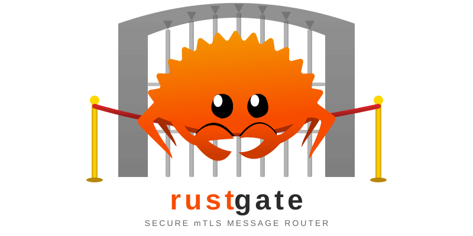

<p align="center">
  
</p>

<p align="center">
  <a href="https://github.com/rchiofalo/rustgate/actions/workflows/ci.yml"></a>
  <a href="https://github.com/rchiofalo/rustgate/releases/latest"></a>
  <a href="https://ghcr.io/rchiofalo/rustgate"></a>
  <a href="https://securityscorecards.dev/viewer/?uri=github.com/rchiofalo/rustgate"></a>
  
  
</p>

<p align="center">
  <em>Secure mTLS message router in Rust — group-based routing, WebSocket, server federation, NATS scaling, certificate enrollment, CRL and FIPS support. Single binary, edge-ready.</em>
</p>

## Table of Contents

- [Why](#why)
- [Quick Start](#quick-start)
- [Architecture](#architecture)
- [Features](#features)
- [Prerequisites](#prerequisites)
- [Building](#building)
- [Running](#running)
- [Docker](#docker)
- [Kubernetes](#kubernetes)
- [Security](#security)
- [Testing](#testing)
- [Documentation](#documentation)
- [Contributing](#contributing)
- [License](#license)

## Why

Existing messaging servers are Java monoliths requiring 8 GB+ RAM, multiple JVM processes, and complex module stacks. They work in fixed infrastructure but fall apart at the edge where resources are constrained and reliability matters most. Federation-only alternatives exist but don't handle client connections.

rustgate is a lightweight alternative that handles mTLS client connections, routes messages by group membership derived from client certificates, and exposes a pluggable protocol interface. Pure Rust, single binary, minimal footprint.

## Quick Start

Generate test certificates and run with Docker Compose:

```bash
# Generate CA
openssl req -x509 -newkey rsa:4096 -keyout ca-key.pem -out ca.pem \
  -days 365 -nodes -subj "/CN=rustgate-ca"

# Generate server cert
openssl req -newkey rsa:4096 -keyout server-key.pem -out server.csr \
  -nodes -subj "/CN=rustgate-server"
openssl x509 -req -in server.csr -CA ca.pem -CAkey ca-key.pem \
  -CAcreateserial -out server.pem -days 365

# Place certs where Docker Compose expects them
mkdir -p certs
cp ca.pem certs/ca.crt && cp server.pem certs/server.crt && cp server-key.pem certs/server.key

# Start
docker compose up -d

# Verify
curl http://localhost:9090/healthz
```

For production certificate management see [docs/tls-certificates.md](docs/tls-certificates.md).

## Architecture

```
┌─────────────────────────────────────────────────────────────────────────────────────────┐
│                                     rustgate-server                                     │
│                                        (binary)                                         │
├──────────────┬──────────────┬──────────────┬──────────────┬──────────────┬──────────────┤
│  rustgate-   │  rustgate-   │  rustgate-   │  rustgate-   │  rustgate-   │  rustgate-   │
│  transport   │  websocket   │  nats        │  enrollment  │  proto       │  federation  │
│  TLS·codec   │  wss://mTLS  │  NATS pubsub │  HTTPS·CSR   │  protobuf    │  V1·V2·gRPC  │
│  router      │  WS sessions │  JetStream   │  Basic Auth  │  XML/proto   │  peer mgmt   │
├──────────────┴──────────────┴──────────────┼──────────────┴──────────────┴──────────────┤
│                rustgate-cot                │               rustgate-core                │
│      CoT XML parsing · MessageBuilder      │    Codec trait · Identity · RoutableMessage│
└────────────────────────────────────────────┴────────────────────────────────────────────┘
```

| Crate | Purpose |
|-------|---------|
| `rustgate-core` | Codec trait, shared types: Identity, RoutableMessage, Destination, framing strategies |
| `rustgate-cot` | Cursor on Target XML parsing and message building |
| `rustgate-transport` | mTLS listener, codec, session management, CRL, FIPS provider, routing engine |
| `rustgate-websocket` | WebSocket (wss://) listener with mTLS client authentication |
| `rustgate-nats` | NATS/JetStream bridge for cross-instance message delivery |
| `rustgate-enrollment` | HTTPS certificate enrollment server (CSR signing, PKCS#12) |
| `rustgate-proto` | Protobuf message translation (XML ↔ proto) |
| `rustgate-federation` | Server-to-server federation: V1 (XML), V2 (gRPC), HA, REST API |
| `rustgate-server` | Binary entry point, CLI, orchestration |
| `rustgate-test-utils` | Test CA and certificate generation helpers |

For detailed architecture documentation see [docs/architecture.md](docs/architecture.md).

## Features

### Transport & Routing

| Feature | Description |
|---------|-------------|
| mTLS | Mutual TLS with client certificate authentication |
| Identity extraction | CN → callsign, OU → groups, SHA-256 → fingerprint |
| Group routing | Broadcast, group, and direct message delivery |
| Codecs | Length-prefixed, XML stream, and line-delimited codecs |
| Position cache | Replay cached positions on client connect |
| Rate limiting | Per-client message rate and burst controls |
| Plaintext input | TCP and UDP listeners for trusted-network scenarios |

### Protocols & Codecs

| Feature | Description |
|---------|-------------|
| WebSocket | wss:// listener with mTLS, interoperable with TCP clients |
| Protobuf | Bidirectional XML ↔ protobuf translation |
| Protocol negotiation | Automatic upgrade from XML to protobuf framing |
| CoT archival | Structured JSONL logging of all received events |
| Data packages | Upload, download, and search via Marti sync API |

### Security

| Feature | Description |
|---------|-------------|
| CRL revocation | PEM-encoded CRL loaded via `--crl`, enforced at TLS handshake |
| FIPS 140-3 | aws-lc-rs crypto provider via `--features fips` ([details](docs/fips.md)) |
| Subject DN enforcement | Enrollment certs carry the authenticated username — prevents impersonation |
| No unsafe code | `unsafe_code = "forbid"` workspace-wide |
| Container hardening | Non-root UID, read-only filesystem, STOPSIGNAL SIGTERM |

### Federation & Scaling

| Feature | Description |
|---------|-------------|
| Federation V1 | Length-prefixed XML over mTLS |
| Federation V2 | gRPC over mTLS with FederatedChannel service |
| Loop detection | Provenance-based with configurable hop limits |
| HA mode | NATS KV distributed claims for multi-pod peer ownership |
| NATS bridge | Publish/subscribe for stateless horizontal scaling with JetStream replay |
| REST API | Peer CRUD and certificate management endpoints |

### Operations

| Feature | Description |
|---------|-------------|
| Prometheus metrics | Connection lifecycle, message routing, NATS, federation ([unauthenticated](docs/deployment.md#ports) — firewall in hostile environments) |
| OpenTelemetry tracing | Distributed trace export via OTLP (Jaeger, Tempo, etc.) |
| Health endpoints | `/healthz` (liveness), `/readyz` (readiness) |
| Graceful shutdown | SIGTERM handling, readiness 503, connection draining |
| Helm chart | Pod Security Standards, PDB, HPA, probes, NetworkPolicy |
| Docker Compose | Local development stack with NATS and JetStream |
| jemalloc | Optional allocator for musl/Alpine production builds |

## Prerequisites

| Dependency | Required | Notes |
|------------|----------|-------|
| Rust 1.93+ | Yes | Pinned in `rust-toolchain.toml` (edition 2024) |
| Rust nightly | Yes | For `cargo +nightly fmt` (CI enforces nightly formatting) |
| protoc | For `proto` / `federation` features | Protocol Buffers compiler |
| Go 1.20+, cmake | For `fips` feature | Required by aws-lc-rs build system |
| nats-server | For NATS integration tests | Install from [nats.io](https://nats.io/download/) |

Optional tooling:

| Tool | Purpose |
|------|---------|
| [cargo-nextest](https://nexte.st/) | CI test runner |
| [cargo-hack](https://github.com/taiki-e/cargo-hack) | Feature powerset checking |
| [cargo-deny](https://github.com/EmbarkStudios/cargo-deny) | License and advisory auditing |
| [cargo-machete](https://github.com/bnjbvr/cargo-machete) | Unused dependency detection |
| Helm | Chart linting |

## Building

```bash
# Default (core transport + routing)
cargo build --release

# With individual features
cargo build --release --features nats           # NATS bridge
cargo build --release --features enrollment     # Certificate enrollment
cargo build --release --features proto          # Protobuf translation (needs protoc)
cargo build --release --features federation     # Server federation (needs protoc)
cargo build --release --features websocket      # WebSocket listener
cargo build --release --features metrics        # Prometheus + health endpoints
cargo build --release --features jemalloc       # jemalloc allocator (musl)
cargo build --release --features fips           # FIPS 140-3 crypto (needs Go + cmake)
cargo build --release --features post-quantum  # PQ key exchange (needs Go + cmake)
cargo build --release --features otel           # OpenTelemetry tracing (needs protoc)

# All features
cargo build --release --all-features
```

### Feature Flags

| Feature | Purpose | Extra build deps |
|---------|---------|-----------------|
| `nats` | NATS/JetStream bridge | — |
| `enrollment` | PKCS#12 enrollment server | — |
| `proto` | Protobuf message support | `protoc` |
| `federation` | Server-to-server federation | `protoc` |
| `federation-ha` | HA federation with JWT | `protoc` |
| `websocket` | WebSocket transport | — |
| `metrics` | Prometheus metrics | — |
| `full-detail` | Extended CoT parsing | — |
| `fips` | FIPS 140-3 crypto (aws-lc-rs) | Go 1.20+, cmake |
| `post-quantum` | Post-quantum key exchange (X25519MLKEM768) | Go 1.20+, cmake |
| `otel` | OpenTelemetry distributed tracing | `protoc` |
| `ocsp` | OCSP stapling for server certificates | — |
| `jemalloc` | jemalloc allocator | — |

## Running

### Configuration file

In addition to CLI flags and environment variables, all server settings can be
loaded from a TOML file. Pass `--config <path>` (or set `RUSTGATE_CONFIG`) to
the binary; keys mirror the CLI flag names in kebab-case:

```toml
# /etc/rustgate/rustgate.toml
bind = "0.0.0.0:4433"
cert = "/etc/rustgate/server.pem"
key  = "/etc/rustgate/server-key.pem"
ca   = "/etc/rustgate/ca.pem"

tls-min-version  = "1.3"
max-connections  = 4096
metrics-bind     = "0.0.0.0:9090"
audit-log        = "/var/log/rustgate/audit.jsonl"

federation-id        = "rustgate-east-1"
federation-v1-bind   = "0.0.0.0:9000"
federation-v2-bind   = "0.0.0.0:9001"
federation-max-hops  = 8

framing  = "tak-negotiate"
encoding = "raw"
```

Settings are merged in this order, with later sources overriding earlier ones:

1. **Built-in defaults** (the same defaults shown in the flag table below)
2. **Configuration file** (when `--config` is set)
3. **Environment variables** (`RUSTGATE_*` and friends)
4. **Command-line flags**

In other words: command-line flags always win, environment variables override
the file, and the file overrides defaults. Unknown keys in the file are
rejected.

Two helper subcommands ship alongside the flag:

```bash
# Print the effective merged configuration as TOML, then exit.
rustgate --config /etc/rustgate/rustgate.toml print-config

# Parse and validate a configuration file (cross-field checks). Exits 0 on
# success, non-zero with a descriptive error on failure.
rustgate --config /etc/rustgate/rustgate.toml validate-config
```

Running `rustgate` with no subcommand starts the server as before.

Minimal:

```bash
rustgate --cert server.pem --key server-key.pem --ca ca.pem
```

Full setup:

```bash
rustgate \
  --cert server.pem --key server-key.pem --ca ca.pem \
  --crl revoked.pem --fips-required \
  --websocket-bind 0.0.0.0:8443 \
  --nats-url nats://localhost:4222 \
  --metrics-bind 0.0.0.0:9090 \
  --federation-v1-bind 0.0.0.0:9000 \
  --federation-v2-bind 0.0.0.0:9001 \
  --framing tak-negotiate
```

<details>
<summary>All configuration flags</summary>

All flags support environment variables (CLI takes precedence):

| Flag | Env Var | Default |
|------|---------|---------|
| `--config` | `RUSTGATE_CONFIG` | — (TOML file; merged under env/CLI) |
| `--bind` | `RUSTGATE_BIND` | `0.0.0.0:4433` |
| `--cert` | `RUSTGATE_CERT` | — |
| `--key` | `RUSTGATE_KEY` | — |
| `--ca` | `RUSTGATE_CA` | — |
| `--crl` | `RUSTGATE_CRL` | — |
| `--crl-warn-stale` | `RUSTGATE_CRL_WARN_STALE` | `true` |
| `--tls-min-version` | `RUSTGATE_TLS_MIN_VERSION` | `1.2` |
| `--cert-reload-interval` | `RUSTGATE_CERT_RELOAD_INTERVAL` | `0` (disabled) |
| `--max-concurrent-handshakes` | `RUSTGATE_MAX_HANDSHAKES` | `100` |
| `--fips-required` | `RUSTGATE_FIPS_REQUIRED` | `false` |
| `--prefer-post-quantum` | `RUSTGATE_PREFER_POST_QUANTUM` | `false` |
| `--kx-groups` | `RUSTGATE_KX_GROUPS` | — (provider default) |
| `--framing` | `RUSTGATE_FRAMING` | `xml` |
| `--encoding` | `RUSTGATE_ENCODING` | `raw` |
| `--max-connections` | `RUSTGATE_MAX_CONNECTIONS` | `1024` |
| `--max-queued-bytes` | `RUSTGATE_MAX_QUEUED_BYTES` | `536870912` (512 MiB) |
| `--max-queued-bytes-low-water` | `RUSTGATE_MAX_QUEUED_BYTES_LOW_WATER` | 90% of high-water |
| `--tcp-bind` | `RUSTGATE_TCP_BIND` | — |
| `--udp-bind` | `RUSTGATE_UDP_BIND` | — |
| `--plaintext-cn` | `RUSTGATE_PLAINTEXT_CN` | `anonymous` |
| `--plaintext-group` | `RUSTGATE_PLAINTEXT_GROUP` | `__plaintext__` |
| `--metrics-bind` | `RUSTGATE_METRICS_BIND` | — |
| `--metrics-per-identity` | `RUSTGATE_METRICS_PER_IDENTITY` | `false` |
| `--metrics-identity-allowlist` | `RUSTGATE_METRICS_IDENTITY_ALLOWLIST` | — |
| `--nats-url` | `RUSTGATE_NATS_URL` | — |
| `--nats-credentials` | `RUSTGATE_NATS_CREDENTIALS` | — |
| `--nats-tls-cert` | `RUSTGATE_NATS_TLS_CERT` | — |
| `--nats-tls-key` | `RUSTGATE_NATS_TLS_KEY` | — |
| `--nats-tls-ca` | `RUSTGATE_NATS_TLS_CA` | — |
| `--nats-tls-required` | `RUSTGATE_NATS_TLS_REQUIRED` | `false` |
| `--nats-subscription-capacity` | `RUSTGATE_NATS_SUBSCRIPTION_CAPACITY` | `1024` |
| `--nats-live-stream` | `RUSTGATE_NATS_LIVE_STREAM` | `RUSTGATE_LIVE` |
| `--nats-max-ack-pending` | `RUSTGATE_NATS_MAX_ACK_PENDING` | `1000` |
| `--nats-checkpoint-path` | `RUSTGATE_NATS_CHECKPOINT_PATH` | — |
| `--websocket-bind` | `RUSTGATE_WEBSOCKET_BIND` | — |
| `--ws-max-frames-per-sec` | `RUSTGATE_WS_MAX_FRAMES_PER_SEC` | `0` (disabled) |
| `--ws-max-bytes-per-sec` | `RUSTGATE_WS_MAX_BYTES_PER_SEC` | `0` (disabled) |
| `--ws-max-violations` | `RUSTGATE_WS_MAX_VIOLATIONS` | `10` |
| `--enrollment-bind` | `RUSTGATE_ENROLLMENT_BIND` | — |
| `--ca-key` | `RUSTGATE_CA_KEY` | — |
| `--enrollment-user` | `RUSTGATE_ENROLLMENT_USER` | — |
| `--enrollment-password` | `RUSTGATE_ENROLLMENT_PASSWORD` | — |
| `--ca-organization` | `RUSTGATE_CA_ORG` | `rustgate` |
| `--enrollment-rate-limit` | `RUSTGATE_ENROLLMENT_RATE_LIMIT` | `10` (per IP per minute, 0 = unlimited) |
| `--data-package-dir` | `RUSTGATE_DATA_PACKAGE_DIR` | — |
| `--package-signature-ca` | `RUSTGATE_PACKAGE_SIGNATURE_CA` | — |
| `--package-strict-signatures` | `RUSTGATE_PACKAGE_STRICT_SIGNATURES` | `false` |
| `--revocation-db` | `RUSTGATE_REVOCATION_DB` | — |
| `--crl-validity-days` | `RUSTGATE_CRL_VALIDITY_DAYS` | `7` |
| `--federation-v1-bind` | `RUSTGATE_FEDERATION_V1_BIND` | — |
| `--federation-v2-bind` | `RUSTGATE_FEDERATION_V2_BIND` | — |
| `--federation-id` | `RUSTGATE_FEDERATION_ID` | `rustgate-federation-1` |
| `--federation-peers-file` | `RUSTGATE_FEDERATION_PEERS_FILE` | — |
| `--federation-skip-hostname-verify` | `RUSTGATE_FEDERATION_SKIP_HOSTNAME_VERIFY` | `false` |
| `--federation-max-hops` | `RUSTGATE_FEDERATION_MAX_HOPS` | `10` |
| `--federation-store-path` | `RUSTGATE_FEDERATION_STORE_PATH` | — |
| `--federation-trust-store-dir` | `RUSTGATE_FEDERATION_TRUST_STORE_DIR` | — |
| `--federation-circuit-breaker-threshold` | `RUSTGATE_FEDERATION_CIRCUIT_BREAKER_THRESHOLD` | `5` |
| `--federation-circuit-breaker-timeout` | `RUSTGATE_FEDERATION_CIRCUIT_BREAKER_TIMEOUT` | `60` |
| `--federation-replay-buffer-size` | `RUSTGATE_FEDERATION_REPLAY_BUFFER_SIZE` | `1000` |
| `--federation-ha-nats-url` | `RUSTGATE_FEDERATION_HA_NATS_URL` | — |
| `--federation-pod-id` | `RUSTGATE_FEDERATION_POD_ID` | — |
| `--replay-window` | `RUSTGATE_REPLAY_WINDOW` | `300` |
| `--dedup-window-secs` | `RUSTGATE_DEDUP_WINDOW_SECS` | `0` (disabled) |
| `--dedup-cache-size` | `RUSTGATE_DEDUP_CACHE_SIZE` | `100000` |
| `--client-msg-rate` | `RUSTGATE_CLIENT_MSG_RATE` | `0` (disabled) |
| `--client-burst` | `RUSTGATE_CLIENT_BURST` | `200` |
| `--circuit-breaker-threshold` | `RUSTGATE_CIRCUIT_BREAKER_THRESHOLD` | `10` |
| `--group-acl-file` | `RUSTGATE_GROUP_ACL_FILE` | — |
| `--archive-dir` | `RUSTGATE_ARCHIVE_DIR` | — |
| `--package-max-age-hours` | `RUSTGATE_PACKAGE_MAX_AGE_HOURS` | `0` (no expiration) |
| `--audit-log` | `RUSTGATE_AUDIT_LOG` | — |
| `--client-queue-dir` | `RUSTGATE_CLIENT_QUEUE_DIR` | — (disabled) |
| `--client-queue-max-bytes` | `RUSTGATE_CLIENT_QUEUE_MAX_BYTES` | `104857600` (100 MiB) |
| `--otel-endpoint` | `OTEL_EXPORTER_OTLP_ENDPOINT` | — |
| `--otel-service-name` | `OTEL_SERVICE_NAME` | `rustgate` |

</details>

### Cross-path deduplication

When the same logical message reaches the server via more than one
ingress path — for example, a directly-connected client and a federation
peer that forwarded the same event — subscribers would normally receive
two copies. Setting `--dedup-window-secs` to a non-zero value enables a
router-level LRU cache keyed by
`SHA-256(uid || 0x00 || time_le || 0x00 || payload)`. For CoT XML the
`uid` attribute is extracted from the payload; for non-CoT payloads
(protobuf, raw binary) `uid` is empty and the key degenerates to a
pure content hash so byte-identical payloads are still deduped. The
router consults the cache before dispatching a message; if the same
key was already seen within the window, the duplicate is dropped before
it reaches any subscriber and the `rustgate_dedup_hits_total` counter is
incremented. The current cache occupancy is exposed as
`rustgate_dedup_cache_size`. Use `--dedup-cache-size` to bound the cache
(default 100 000 entries, oldest evicted in LRU order). Disabled by
default.

### NATS JetStream consumer lag metrics

When built with `--features metrics,nats` and `--nats-url` is configured,
the NATS pull-consumer subscriber polls `consumer.info()` every five
seconds and exports three gauges so operators can alert on cross-instance
bridge lag and redelivery storms:

- `rustgate_nats_consumer_pending` — messages pending delivery to this
  instance's pull consumer (`num_pending`).
- `rustgate_nats_consumer_num_redelivered` — current count of messages in
  a redelivered state (`num_redelivered`).
- `rustgate_nats_consumer_ack_floor_stream_seq` — stream sequence of the
  highest contiguous ACK (`ack_floor.stream_seq`); a flat value while
  `pending` grows indicates the consumer is stuck.

### Per-identity metrics (bounded cardinality)

`messages_routed_total` and `messages_dropped_total` carry an
`identity_cn` label so operators can attribute routing volume and rate-limit
drops to individual clients. To prevent unbounded label growth from large
or untrusted client populations, the label is bucketed against an optional
allowlist (`--metrics-identity-allowlist`, one CN per line, `#` comments
allowed). CNs that are not in the allowlist — or **all** CNs when the
allowlist is unset — collapse into the literal `"other"` bucket, capping
per-identity cardinality at 1 by default.

Set `--metrics-per-identity` (or `RUSTGATE_METRICS_PER_IDENTITY=true`) to
additionally register the Tier 2 per-identity metrics:
`rustgate_per_identity_handshake_failures_total`,
`rustgate_per_identity_session_duration_seconds`,
`rustgate_per_identity_bytes_sent_total`, and
`rustgate_per_identity_bytes_received_total`. When the flag is disabled
(the default), these metrics are not registered at all and impose zero
overhead.

**Scope:** per-identity labels currently cover the TLS and plaintext TCP
transports only. WebSocket sessions are not yet labelled and will not appear
in `identity_cn`-labelled series. Byte counters report **application payload
bytes** (post-decode / pre-encode), not wire bytes — they exclude TLS,
framing, and codec overhead.

## Docker

```bash
docker compose up -d
```

This starts NATS with JetStream, a one-shot stream setup container, and rustgate on port 4433 with metrics on 9090.

The Dockerfile builds all features (including jemalloc) in a multi-stage Alpine build. The final image runs as UID 10001 with a read-only root filesystem. Health is checked via `/healthz` on port 9090.

To build the image standalone:

```bash
docker build -t rustgate .
```

## Kubernetes

A Helm chart is provided in `helm/`:

```bash
helm install rustgate helm/ --set tls.secretName=my-tls-secret
```

The chart includes Pod Security Standards (restricted profile), startup/liveness/readiness probes, PodDisruptionBudget, HorizontalPodAutoscaler, graceful shutdown with connection draining, optional federation, and NetworkPolicy.

For full deployment documentation see [docs/deployment.md](docs/deployment.md).

## Security

- **mTLS everywhere** — all client and federation connections require mutual TLS with certificate verification
- **CRL revocation** — revoked certificates are rejected at the TLS handshake via `--crl`
- **OCSP stapling** — optional `ocsp` feature staples OCSP responses to the server certificate (see below)
- **FIPS 140-3** — optional aws-lc-rs crypto provider for FIPS-validated TLS ([details](docs/fips.md))
- **No unsafe code** — `unsafe_code = "forbid"` enforced workspace-wide
- **No panics** — `clippy::panic = "deny"` and `clippy::unwrap_used = "deny"` in production code
- **Subject DN enforcement** — enrollment certificates carry the authenticated username to prevent impersonation
- **Container hardening** — non-root UID (10001), read-only filesystem, STOPSIGNAL SIGTERM
- **TLS session resumption disabled** — forces full handshake with CRL check on every connection

### OCSP stapling

Build with `--features ocsp` and pass `--ocsp-stapling` (env `RUSTGATE_OCSP_STAPLING`) to wrap the
server certificate resolver with [`ocsp-stapler`](https://crates.io/crates/ocsp-stapler). The
stapler runs a background tokio task that periodically fetches an OCSP response for the active
certificate from the issuing CA's OCSP responder and attaches it to the TLS handshake, so clients
can verify revocation status without contacting the CA themselves.

Notes:

- **Best with private / enterprise CAs.** Let's Encrypt stopped serving OCSP responses in 2025.
  OCSP stapling is most valuable for internal PKIs that operate their own OCSP responder.
- **First handshakes after startup may be unstapled** until the background fetcher completes its
  initial cycle (~60s). The server preloads the active certificate into the stapler at startup so
  the fetch is queued immediately, but the very first handshakes can still arrive before the
  response lands. This is the same fallback path clients already use when stapling is off.
- **After a certificate rotation (SIGHUP or polling), there is a brief window — typically under
  one minute — during which handshakes may be served unstapled until the background fetcher
  refreshes.** The SIGHUP path also re-preloads the rotated certificate into the stapler to
  shorten this window.
- **Requires outbound network access to the issuing CA's OCSP responder**; air-gapped deployments
  should leave this flag off.
- **Responder failures degrade gracefully** — handshakes continue without a stapled response.
- **CRL and OCSP can be enabled together.** OCSP stapling lives on the *server certificate*
  resolver path; CRL revocation lives on the *client certificate* verifier path. They are
  independent layers and may be combined freely.
- **SHA-1 OCSP requests.** The upstream `ocsp-stapler` crate currently issues OCSP requests with
  SHA-1 issuer hashes. Most CAs accept this — verify compatibility with strict modern responders.

For security policy and vulnerability reporting see [SECURITY.md](SECURITY.md).

## Testing

```bash
cargo nextest run                              # All tests (default features)
cargo nextest run --features fips              # FIPS-gated tests
cargo nextest run -p rustgate-nats --test integration  # NATS integration (needs nats-server)
```

| Crate | Test files | Covers |
|-------|-----------|--------|
| `rustgate-transport` | `tls_listener`, `e2e_routing`, `encoder`, `crl`, `fips`, `cert_rotation` | mTLS, routing, codecs, CRL, FIPS, certificate hot-reload |
| `rustgate-cot` | `parser` | CoT XML parsing |
| `rustgate-core` | `types` | Core type invariants |
| `rustgate-enrollment` | `server_integration` | PKCS#12 enrollment, CSR signing |
| `rustgate-federation` | `v2_integration`, `api_integration`, `ha_integration` | Federation V2 protocol, REST API, HA coordination |
| `rustgate-nats` | `integration` | NATS bridge, echo prevention, JetStream replay |
| `rustgate-proto` | `codec_integration` | XML ↔ protobuf conversion |
| `rustgate-server` | `cli_parsing`, `tls_config`, `feature_gates`, `archive_integration` | CLI validation, TLS setup, feature gating, CoT archival |
| `rustgate-websocket` | `ws_listener`, `ws_server` | WebSocket mTLS, session routing |

All tests use ephemeral certificates generated at runtime via `rustgate-test-utils` — no fixture files.

## Documentation

| Document | Description |
|----------|-------------|
| [Architecture](docs/architecture.md) | System design and crate responsibilities |
| [TLS Certificates](docs/tls-certificates.md) | Certificate requirements, generation, and management |
| [Deployment](docs/deployment.md) | Binary, Docker Compose, and Kubernetes deployment |
| [FIPS 140-3](docs/fips.md) | FIPS crypto provider setup and known limitations |
| [Configuration](docs/configuration.md) | All CLI flags, env vars, and runtime options |
| [Security Posture](docs/security-posture.md) | NIST 800-53 control mapping and compliance overview |
| [Threat Model](docs/threat-model.md) | STRIDE methodology threats, mitigations, and residual risks |
| [Graceful Degradation](docs/graceful-degradation.md) | Subsystem failure modes and recovery behavior |
| [Post-Quantum Roadmap](docs/post-quantum.md) | Path to post-quantum cryptographic protection |
| [Observability](docs/observability.md) | Structured logging, metrics, and distributed tracing |
| [Runbooks](docs/runbooks/) | Operational runbooks for federation, memory, NATS |
| [CONTRIBUTING](CONTRIBUTING.md) | Build prerequisites, code quality, and PR guidelines |
| [CHANGELOG](CHANGELOG.md) | Release history in Keep a Changelog format |
| [SECURITY](SECURITY.md) | Security policy and vulnerability reporting |

## Contributing

See [CONTRIBUTING.md](CONTRIBUTING.md) for prerequisites, building, testing, code quality standards, and pull request guidelines.

## License

Proprietary. See [LICENSE](LICENSE) for details.
